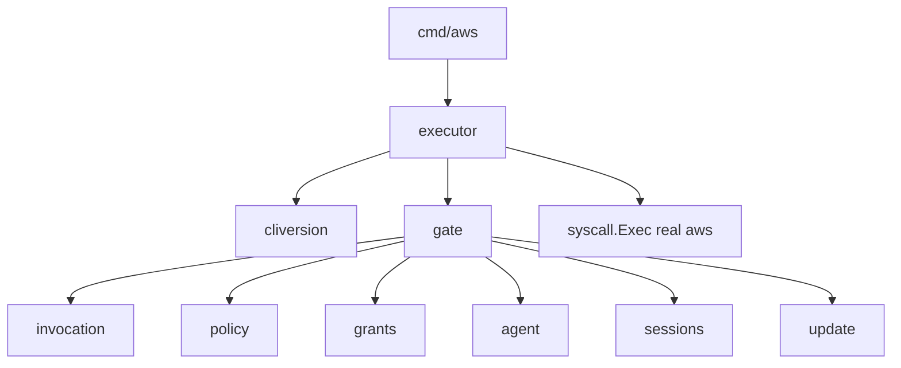
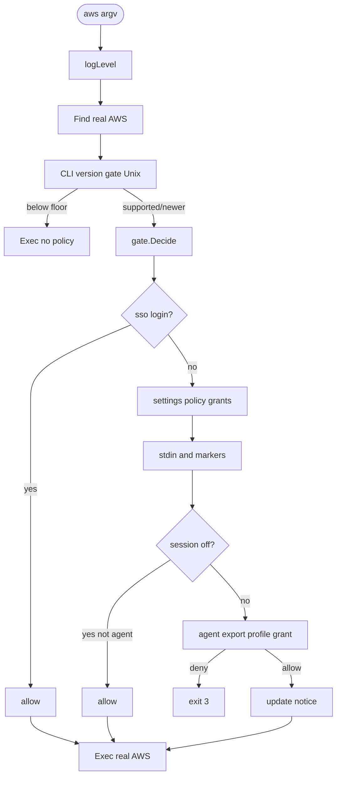

# Architecture

This document describes how AWS CLI Guard behaves in the current codebase. Intent and principles live in [DESIGN.md](DESIGN.md). Non-obvious pitfalls are in [FINDINGS.md](FINDINGS.md).

## Overview

Two binaries ship from this repository:

- **`aws`** ([cmd/aws/main.go](../cmd/aws/main.go)) — PATH wrapper that enforces policy, then replaces itself with the real AWS CLI on Unix.
- **`aws-guard`** ([cmd/aws-guard/main.go](../cmd/aws-guard/main.go)) — control plane for policy, grants, install, and operator switches.

A third entry mode exists: when `argv[0]` is `aws-cli-guard-update-check`, the wrapper runs the detached update helper and exits without touching AWS.

On Linux and macOS, an allowed command ends in `syscall.Exec` of the resolved real CLI. The wrapper never returns success on that path, so the parent observes the CLI's exit code. Wrapper cancellations exit **3** — reserved so they never collide with AWS CLI codes.

## Package map

Packages live under `internal/`. Arrows are typical call direction (not every import).

| Package | Role |
| --- | --- |
| **agent** | Stdin class + built-in environment-marker recognition → **environ** |
| **awsconfig** | Parse shared/credentials INI without secrets → **environ** |
| **cache** | Cache dir, `cli-version.json`, `updates.json` → **paths**, **decode**, **files**, **cliversion** |
| **cli** | `aws-guard` dispatch → policy, grants, settings, install, sessions, … |
| **cliversion** | Compare `aws-cli/X.Y.Z` to floor and ceiling |
| **decode** | Strict versioned TOML/JSON loaders |
| **diagnose** | Secret-safe corrupt-file hints → **output** |
| **environ** | Lookup in `[]string` environment slices |
| **executor** | Find real `aws`, CLI version gate, exec → **cache**, **gate** |
| **files** | `0700`/`0600`, locks, atomic writes, no symlinks on guard paths |
| **gate** | Wrapper decision path → **policy**, **grants**, **agent**, **update** |
| **grants** | `grants.json` fingerprints and TTL grants → **awsconfig** |
| **install** | Install, upgrade, shell hooks, manifest → **paths**, **files** |
| **invocation** | Global option table, login detection, export commands |
| **output** | `aws-cli-guard:` stderr prefixes, exit 3 cancel |
| **paths** | Config, state, cache, install prefix resolution |
| **policy** | `config.toml` load, evaluate, migrate |
| **session** | Session ID (`getsid`), controlling TTY → **sessions** |
| **sessions** | Append-only `sessions.json` |
| **settings** | `settings.toml` |
| **subject** | Resolve profile subject from argv/env → **invocation** |
| **terminal** | Confirm phrases on `/dev/tty` |
| **update** | Auto-update cache, detached check, in-place replace |
| **verbose** | Tight vs verbose decision logging |
| **version** | Release stamp embedded at link time |

## The `aws` decision path

### Before `gate.Decide`

1. **Update-check argv** — if invoked as `aws-cli-guard-update-check`, run helper only.
2. **Log level** — `AWS_CLI_GUARD_LOG` must be `tight` or `verbose` when set; otherwise cancel.
3. **Find real AWS** — walk `PATH` or honor `AWS_CLI_GUARD_REAL_AWS`; skip every wrapper copy; refuse if override points at a wrapper.
4. **CLI version** (Unix) — probe or read `cli-version.json` keyed by session id and binary identity. Below floor **2.9.0** or unreadable: warn and **skip policy**. Between floor and verified ceiling **2.40.3**: run policy. Above ceiling: warn once per session, still run policy.
5. **`gate.Decide`** when policy applies — refusal exits **3**.
6. **`ExecRealAWS`** — failure to start cancels with **3**.

### Inside `gate.Decide`

1. Reconcile verbose level from env + settings (after settings load).
2. **Parse invocation** — global options and command token ([internal/invocation](../internal/invocation)).
3. **`aws sso login`** — recognized login forms hand off immediately; settings, policy, and grants are not loaded.
4. **Policy file present** — missing `config.toml` cancels with init guidance.
5. **Subject** — resolve named profile, environment credentials, or unresolved; warn on `default` profile.
6. **Load** `settings.toml`, `config.toml`, `grants.json` — corrupt or unsupported versions cancel (**3**).
7. **Caller context** — classify stdin; if `environment_markers` is on, scan catalog env vars; invalid stdin class cancels.
8. **Session off** — unless caller is a recognized agent, honor `sessions.json` `off` for this session id + terminal binding → warn and allow (still runs update notice path).
9. **Agent profile rules** — for recognized agents, evaluate `[agents]` actions before ordinary profile rules.
10. **Credential export** — `configure export-credentials` and qualifying `configure get` use `[credential_export]`.
11. **Profile + grant** — evaluate profile action; for `prompt`, require matching grant fingerprint and non-expired TTL.
12. **Update handoff** — non-blocking read of `updates.json`; may spawn detached `Setsid` helper when auto-update is on.
13. **Allow** — return to executor for exec.

## Policy evaluation

### Subjects

- **Named profile** — from `--profile`, config default, or implied by command.
- **`default`** — explicit or implicit default profile; stderr warning on each guarded use.
- **Environment credentials** — access key env vars without a profile name.
- **Unresolved** — cannot determine subject; fail closed.

### Precedence (simplified)

Login handoff bypasses all policy. Session off bypasses policy for non-agents. Recognized agents consult `[agents]` before normal profile rules. Credential-export commands use `[credential_export]` before profile rules. Grants satisfy `prompt` only when fingerprint matches.

### Credential export commands

Treated as printing access keys:

- `aws configure export-credentials`
- `aws configure get` with no args, one arg that names a secret field, or more than one arg

Policy key: `[credential_export] action` defaulting to restrictive in generated policy.

## Grants

Grants live in `grants.json` under the state directory. Each record has profile name, expiry, and a **source fingerprint** derived from AWS config/credentials files (account ids, role ARNs, SSO fields, chains).

### Chain resolution

When resolving `source_profile`, `credential_source`, or `sso_session`, the walker follows at most **eight** hops, detects cycles, and includes `[sso-session]` metadata in v2 fingerprints. Version 1 grants load for compatibility; new writes use version 2 with required `chain` array.

### Match statuses

Grant check returns whether a grant exists, is expired, mismatched on source, or unreadable. Only a current fingerprint match satisfies `prompt`.

## Reading AWS config files

`internal/awsconfig` parses INI aligned with botocore conventions. Secret values are not copied into errors. `AWS_CONFIG_FILE` and `AWS_SHARED_CREDENTIALS_FILE` are honored via the invocation environment slice.

## Global-option parser

`internal/invocation/globals.go` implements AWS CLI global options supported through verified ceiling **2.40.3**, including additions such as `--cli-error-format`, `--output off`, `--help`, and login-related globals. Unknown globals that take values can shift how command and operation are detected — see [FINDINGS.md](FINDINGS.md).

## On-disk state

### Paths

Guard-owned paths derive from the user database home (`os/user.Current()`). When lookup fails or home is empty/non-absolute, **`HOME`** is used without warning — an accepted bypass for LDAP/SSOD accounts without CGO.

**`XDG_*` is not used.** Production builds ignore `AWS_CLI_GUARD_*_DIR`; those overrides compile only with `awsguard_testpaths` for tests and dogfood scratch dirs.

| Kind | Default location |
| --- | --- |
| Config | `~/.config/aws-cli-guard/config.toml` |
| State | `~/.local/state/aws-cli-guard/grants.json`, `sessions.json` |
| Cache | `~/.cache/aws-cli-guard/cli-version.json`, `updates.json` |
| Install prefix | `~/.local/share/aws-cli-guard` (override with `aws-guard install --prefix`) |

### File guarantees

Writes use private permissions, refuse symlinks on target paths, advisory locks where needed, and atomic replace via partial files. Recovery and migrate copy aside with `.partial.` / `.migrated.` suffix patterns before rewriting.

### Lifecycle

- **Strict decode** — unknown JSON keys, duplicate JSON keys, unknown TOML keys, and wrong `version` cancel loads.
- **Recover** — operator command moves corrupt bytes aside and writes safe defaults.
- **Migrate** — explicit rewrite to newest supported schema; live `aws` never migrates.

## File formats

### `config.toml` (policy)

| Version | Adds |
| --- | --- |
| 1 | `[defaults]`, `[profiles]`, `[credential_export]` |
| 2 | `[environment]` action |
| 3 | `[agents.detection] environment_markers` |
| 4 | `[agents]` default and per-profile actions when markers on |

`aws-guard init` writes **version 2**. `aws-guard migrate` targets **version 4** today.

### `grants.json`

| Version | Adds |
| --- | --- |
| 1 | Fingerprint without required `chain` |
| 2 | Required `source.chain` hop list |

New grants use version 2.

### `settings.toml` (schema 1)

- `[identity].verify` — only `false` allowed today (`true` rejected).
- `[logging].level` — `tight` or `verbose`.
- `[updates].auto` — `true`/`false`; absent section means user was not asked yet (init may prompt).

### `sessions.json` (schema 1)

Records: `session_id`, `effect` (`off`/`on`), `token`, `at`, optional `tty` binding (`path`, `dev`, `ino`, `rdev`). `off` requires terminal binding.

### `cli-version.json` (schema 1)

Per-session cache of CLI version probe vs floor/ceiling.

### `updates.json` (schema 1)

Last check result and user notice state for auto-update.

## Control plane commands

| Command | Terminal | Reads | Writes |
| --- | --- | --- | --- |
| `init` | Optional TTY for update prompt | settings, cache | `config.toml`, `settings.toml` |
| `allow` | Confirm profile on TTY | policy, awsconfig, grants | `grants.json` |
| `revoke` | No | grants | `grants.json` |
| `policy list` | No | policy | — |
| `policy explain` | No | policy, grants | — |
| `config validate` | No | policy | — |
| `grants list` | No | grants | — |
| `recover …` | Confirm per target | respective store | aside + reset |
| `migrate` | No | policy, grants | bump schema versions |
| `install` | No | release bundle | prefix + manifest |
| `upgrade` | No | manifest, policy | replace binaries, migrate |
| `off` | TTY confirm + controlling TTY | session | `sessions.json` |
| `on` | No | session | `sessions.json` |
| `disable` / `enable` | disable script uses TTY | manifest | swap `aws` via script |
| `shell bash\|zsh` | No | home | startup file block |
| `help`, `version` | No | embedded version | — |

Per-command `--help` is not implemented yet; see GitHub issue tracker.

## Agent detection

Three policy switches under `[agents.detection]` (see schema version 3+). Built-in catalog today:

| Variable | Evidence |
| --- | --- |
| `CURSOR_AGENT` | Observed on Cursor 3.29.9 |
| `CLAUDE_CODE_CHILD_SESSION` | Vendor-documented for Claude Code v2.1.172+; ordinary IDE terminals do not set it |

`CLAUDECODE` is intentionally excluded because human IDE shells set it.

Test builds with `awsguard_testpaths` also honor `AWS_CLI_GUARD_TEST_AGENT`.

Recognition sets caller context to **recognized agent**; only then do `[agents]` profile actions apply. Session off is **not** honored for recognized agents when detection is on.

## Session off

`aws-guard off` appends an `off` record keyed by session id (`getsid`) and bound to the controlling terminal device. `aws-guard on` clears effect for the session.

macOS resolves tty device path via `fcntl(F_GETPATH)` where needed. New terminals may reuse kernel session ids, so binding uses tty identity, not session id alone.

Recognized agents ignore session off when agent rules are active — policy still applies.

## Install, upgrade, and persistent disable

### Prefix layout

Default prefix: `~/.local/share/aws-cli-guard`. Reserved sibling names include `aws`, `aws-guard`, `aws-cli-guard-disable`, `aws.aside`, `aws-cli-guard-disabled`, `aws.incoming`, `real_aws` reference in manifest, and `aws-cli-guard-manifest`.

### Manifest (seven lines)

`version=`, `aws=`, `aws_guard=`, `real_aws=`, `disable_script=`, `aside=`, `marker=` — absolute paths, fixed order.

Install uses **exclusive create** (`O_CREAT|O_EXCL`) so a partial install cannot clobber an existing file.

### Persistent disable

`aws-cli-guard-disable` (POSIX `sh`) swaps wrapper → `aws.aside`, installs stand-in `aws` that execs manifest `real_aws`, and writes a marker file. `enable` restores from aside. Confirms phrase on `/dev/tty`. Refuses symlinks on swap targets.

`aws-guard disable`/`enable` invoke the same script logic via the installed copy.

### Shell startup

`aws-guard shell bash|zsh` inserts a marked `PATH` block into `.bashrc` or `.zshrc`.

## Releases and auto-update

Tag `v*` triggers the draft **Release** workflow building four platform archives, `checksums.txt`, and `install.sh`. That workflow does not sign anything.

A separate **Sign Release Checksums** workflow (`workflow_dispatch`, GitHub Environment **Production** with required reviewers) may sign the draft's `checksums.txt`: the operator supplies the file's SHA-256 after verifying it out-of-band, a reviewer approves the environment, the job re-downloads `checksums.txt` from the draft, rejects a digest mismatch, signs with `MINISIGN_SECRET_KEY` (not available to the build job), checks the signature against [internal/update/minisign.pub](../internal/update/minisign.pub), and uploads `checksums.txt.minisig`. Maintainers may still sign offline and upload the signature by hand.

Release verification order (install script and auto-update helper):

1. Download the platform archive, `checksums.txt`, and `checksums.txt.minisig`.
2. Verify the minisign signature on the exact `checksums.txt` bytes against the public key in [internal/update/minisign.pub](../internal/update/minisign.pub) (also pinned in [install.sh](../install.sh)). The trusted comment must name `file:checksums.txt`.
3. Verify the archive SHA-256 line in `checksums.txt`, then unpack.

Auto-update (when enabled in settings):

- Live `aws` only reads cache and may spawn detached helper — no network in the hot path.
- Helper follows the verification order above, replaces install prefix binaries, runs migrate when needed.
- Helper never writes `real_aws` in the manifest.

Fixed GitHub org/repo URLs and the release public key are compiled into the updater; notices surface through cache state in `updates.json`.

## Output, exit status, and logging

| Prefix | Meaning |
| --- | --- |
| `aws-cli-guard: error:` | Cancellation; exit **3** |
| `aws-cli-guard: warning:` | Command still runs |
| other `aws-cli-guard:` detail | Diagnosis, profile, grant hints |

Verbose mode prints a decision block (policy load paths, subject, grant status). Secrets and raw env values are redacted.

## Platform support

Supported: Linux and macOS on `amd64` and `arm64`. Windows builds compile `!unix` stubs; the wrapper does not exec there.

Run `make check` on macOS before merging changes to paths, exec, tty capture, or file durability code.

## How tests are built

- **`make test`** uses `-tags=awsguard_testpaths` and re-tests `internal/paths` and `internal/agent` without the tag.
- Integration tests spawn `./cmd/aws` as a subprocess with [fakeaws](../internal/executor/testdata/fakeaws) as real CLI — `syscall.Exec` cannot be asserted in-process.
- Race detector enabled (`CGO_ENABLED=1`) for tests; release build stays `CGO_ENABLED=0`.

Never run an untagged `go test ./...` against your real home directory.

## Policy file sections (version 4)

`[defaults]` sets default `action` and `approval_ttl` for profiles without overrides.

`[profiles.<name>]` sets `action` per profile. Profile names with dots must be quoted in TOML.

`[environment]` applies when the subject is environment credentials (access key env vars).

`[credential_export]` applies to configure export/get commands that would print keys.

`[agents.detection]` holds `environment_markers` (boolean). When false or absent, built-in markers are not consulted.

`[agents]` holds `default` and `[agents.profiles.<name>]` actions. Valid only when `environment_markers` is true and at least one agent action exists.

Unknown keys at a given schema version fail validation with a field path in the error.

## Recover and migrate

`aws-guard recover <target>` moves the live file aside (`*.recover.*` pattern) and writes init-safe defaults after terminal confirmation. Targets: `policy`, `grants`, `settings`, `cache` (rebuild directory), `sessions`.

`aws-guard migrate` copies aside (`*.migrated.*`) then rewrites policy to version 4 and grants to version 2 when needed. It does not enable agent detection or add keys the user never set. The live `aws` path never calls migrate.

## Verbose decision block

When logging is verbose, stderr may include: effective paths (user-database vs `HOME` fallback), loaded schema versions, stdin class, agent recognition result, grant fingerprint status, and the rule that refused. Values that could contain secrets are omitted or redacted.
